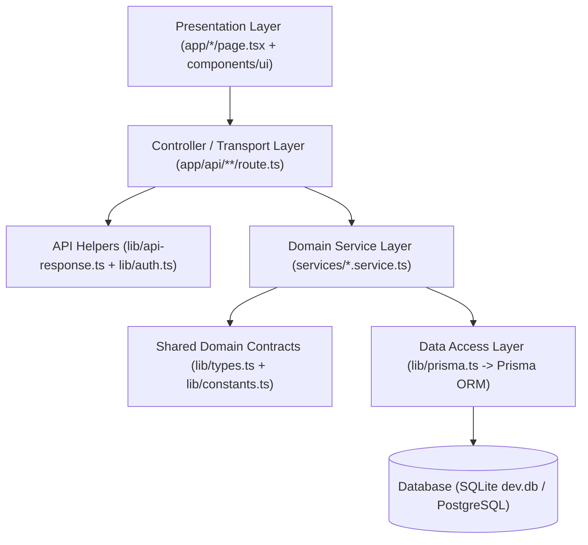

# Priya Boutique CRM — System Architecture

## 1. Architectural Overview

Priya Boutique CRM follows a **4-layer modular architecture** built on Next.js 14 (App Router), TypeScript, Prisma ORM, and NextAuth.js.



---

## 2. Directory Structure

```text
d:\CRM
├── app/                        # Next.js App Router (Pages + API Controllers)
│   ├── api/                    # Thin HTTP route handlers (dynamic = "force-dynamic")
│   ├── dashboard/              # Owner Command Center (KPIs, Alerts, Tabs)
│   ├── leads/                  # Lead List + Detail History (/leads/[id])
│   ├── pipeline/               # Drag-and-drop Kanban Board
│   ├── followups/              # Today / Overdue / Upcoming Follow-up Manager
│   ├── lead-reports/           # Funnel, Source, and Staff Conversion Reports
│   ├── orders/                 # Omnichannel Orders & COD Verification
│   ├── returns/                # Returns, QC, and Refunds
│   ├── inbox/                  # Unified Support Inbox
│   ├── analytics/              # Revenue, Channel, and Return Analytics
│   ├── shop/                   # In-store POS & Quick Billing
│   ├── chatbot/                # 24x7 Hindi/Hinglish AI Assistant Simulator
│   └── settings/               # Team Management & Lead Assignment
├── components/
│   ├── Providers.tsx           # SessionProvider wrapper
│   └── ui/                     # Reusable UI primitives + barrel export (index.ts)
│       └── CssIcon.tsx         # Pure CSS icon system (zero SVG/emoji dependencies)
├── services/                   # Domain Service Layer (business rules & Prisma queries)
│   ├── lead.service.ts         # Lead CRUD, stage history audit, & funnel reporting
│   └── staff.service.ts        # Staff management & monthly target calculation
├── lib/                        # Core infrastructure & shared contracts
│   ├── api-response.ts         # apiOk, apiError, parseIntParam, withApiHandler
│   ├── auth.ts                 # NextAuth Credentials + JWT role injection
│   ├── constants.ts            # Single source of truth for enums & stage metadata
│   ├── prisma.ts               # Singleton PrismaClient
│   ├── types.ts                # Shared TypeScript DTOs and domain interfaces
│   └── utils.ts                # Formatting & date helpers
├── prisma/
│   ├── schema.prisma           # Normalized relational schema (21 models)
│   └── seed.ts                 # Idempotent demo seed script
└── styles/
    └── globals.css             # Tailwind base + pure CSS icon definitions
```

---

## 3. Core Design Principles

1. **Separation of Concerns**:
   - **Pages (`app/*/page.tsx`)** handle UI state, Framer Motion transitions, and user interactions.
   - **API Routes (`app/api/**/route.ts`)** act as thin HTTP controllers using `withApiHandler`, `parseIntParam`, `apiOk`, and `apiError`.
   - **Services (`services/*.service.ts`)** encapsulate business logic (e.g., automatic `LeadHistory` audit logging on stage transitions, monthly sales target aggregation) and database queries.
2. **Single Source of Truth**:
   - Domain enums (`LEAD_STAGES`, `LEAD_TEMPERATURES`, `LEAD_SOURCES`, `ORDER_STATUSES`, `STAFF_ROLES`) live in `lib/constants.ts` and drive both TypeScript types (`lib/types.ts`) and service queries.
3. **Zero-Dependency Pure CSS Iconography**:
   - `components/ui/CssIcon.tsx` paired with `styles/globals.css` renders all UI icons via pure CSS geometry (`::before`, `::after`, borders, transforms), avoiding external SVG icon bundles.
4. **Role-Based Access Control (RBAC)**:
   - `OWNER`: Full access to Command Center (`/dashboard`), Analytics, Lead Reports, Team Settings, and all operational modules.
   - `STAFF`: Access to POS Billing (`/shop`), Orders, Inbox, Returns, Leads, Pipeline, Follow-ups, and AI Bot.
5. **Production / Vercel Readiness**:
   - Database-backed `GET` API routes export `dynamic = "force-dynamic"` to prevent static build-time execution failures.
   - `npm run build` runs `prisma generate && next build`.
